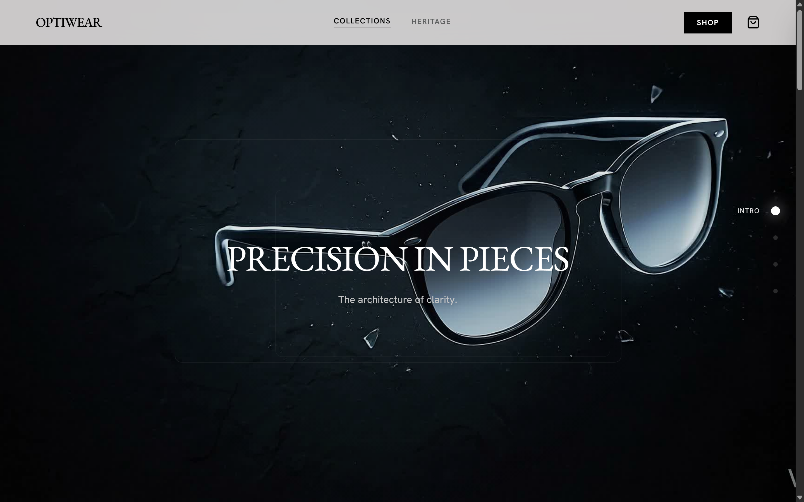
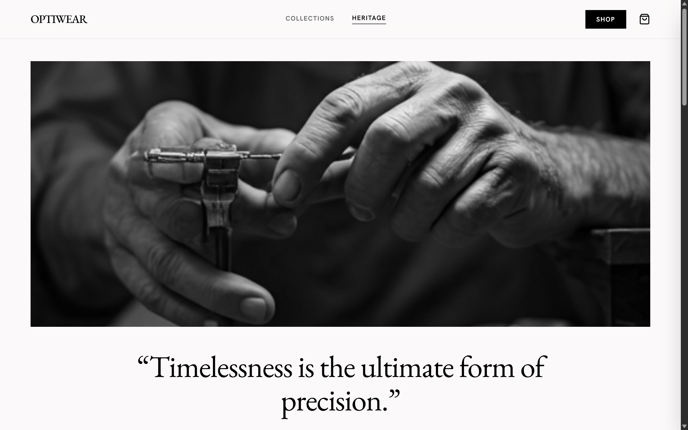
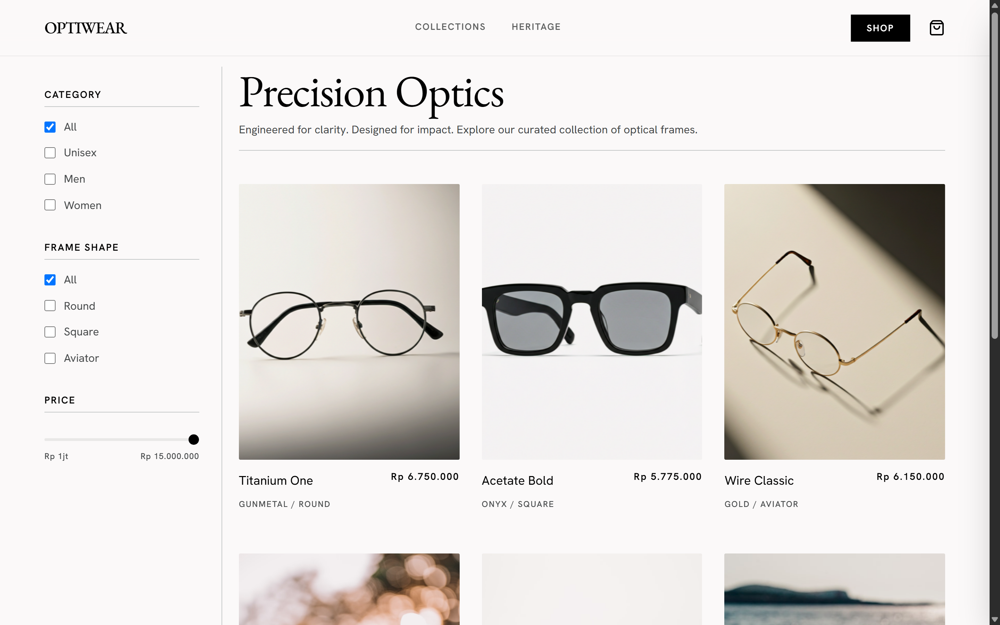

# OPTIWEAR — Precision Eyewear

<div align="center">
  
  <p><em>A visually immersive, luxury scrollytelling experience for precision optics</em></p>
  <p>
    <strong><a href="https://optiwear-scrollytelling.vercel.app/">🌟 View Live Demo</a></strong>
  </p>
</div>

[](https://nextjs.org/)
[](https://tailwindcss.com/)
[](https://www.typescriptlang.org/)
[](https://greensock.com/)
[](https://github.com/darkroomengineering/lenis)
[](https://optiwear-scrollytelling.vercel.app/)

---

## Overview

**OPTIWEAR** is a luxury eyewear digital experience blending cinematic scrollytelling, editorial brand storytelling, and an e-commerce catalog. Powered by **Next.js 14 (App Router)**, **GSAP ScrollTrigger**, and **Lenis**, it delivers synchronized 120-frame canvas animations, interactive chapter jumping, and e-commerce shopping interactions.

---

## Experience Showcase

| Heritage Storytelling (`/heritage`) | Curated Catalog & Shop (`/shop`) |
| :---: | :---: |
|  |  |

---

## Key Features

### 1. Canvas-Based Scrollytelling Hero
- High-performance **120-frame image sequence** rendered dynamically to an HTML5 `<canvas>`.
- Perfectly scrubbed in real-time with scroll position using **GSAP ScrollTrigger**.
- Sticky viewport staging with layered typography reveals (*"Titanium Skeleton"*, *"Sapphire Crystal"*, *"Hand-Finished Heritage"*).

### 2. Interactive Dot Navigation
- Floating right-aligned chapter indicator syncing with active viewport sections via GSAP `ScrollTrigger`.
- Smooth auto-scrolling to specific story milestones (*Intro*, *Titanium Skeleton*, *Sapphire Crystal*, *Heritage*) powered by **GSAP ScrollToPlugin**.

### 3. Glassmorphism Navigation & Responsive Mobile Menu
- Sticky frosted-glass header (`backdrop-blur-xl`) with active route indicators and live cart badge counter.
- Optimized mobile overlay menu featuring glassmorphism cards and animated drawer toggles.

### 4. Editorial Heritage Experience (`/heritage`)
- **Hero Manifesto**: High-contrast typography paired with editorial photography.
- **Craftsmanship Pillars**: Interactive breakdown of raw materials, hand-polishing techniques, and precision alignment.
- **Evolution Timeline**: Multi-era milestone grid accompanied by GSAP scroll-reveal transitions.

### 5. Curated Shop & E-Commerce Workflow (`/shop`)
- **Multi-Facet Sidebar Filters**: Filter frames on-the-fly by category (*Men*, *Women*, *Unisex*), shape (*Aviator*, *Round*, *Square*), and max price slider.
- **Responsive Product Grid**: Dynamic 2-column mobile layout and 3-column desktop layout with Indonesian Rupiah (IDR) currency formatting.
- **Dynamic Product Detail Route (`/shop/[id]`)**: Interactive color variant picker, detailed dimensions & specifications, and instant add-to-cart.
- **Slide-Over Cart Drawer**: Global state management powered by React Context, item quantity controls, and live subtotals.
- **3-Step Mock Checkout Modal**: Realistic e-commerce checkout flow simulating address submission, animated payment processing, and order confirmation.

### 6. Lenis Smooth Scrolling Engine
- Unified requestAnimationFrame loop binding **Lenis** smooth scroll directly to the **GSAP ticker** with `lagSmoothing(0)` for zero scroll stutter or desynchronization.

---

## Tech Stack

| Layer | Technology | Details |
| :--- | :--- | :--- |
| **Framework** | Next.js 14.2 (App Router) | Server & client components, optimized static/dynamic route generation |
| **Language** | TypeScript 5 | Strict typing across state, props, and mock catalog models |
| **Styling** | Tailwind CSS 3.4 | Custom luxury design tokens, animations (`tailwindcss-animate`) |
| **Typography** | Next.js Google Fonts | EB Garamond (Editorial Serif) & Hanken Grotesk (Modern Sans) |
| **Animation Engine** | GSAP 3.15 | ScrollTrigger & ScrollToPlugin for scrubbed frame & element reveals |
| **Smooth Scrolling** | Lenis 1.3 | Inertial smooth scrolling synced to GSAP ticker |
| **State Management**| React Context API | Global cart state, item quantities, and checkout lifecycle |
| **Icons & UI** | Lucide React & Base UI | Clean minimalist iconography and component primitives |
| **Hosting** | Vercel | Automatic deployments with edge network delivery |

---

## Project Structure

```
optiwear/
├── public/
│   ├── assets/
│   │   └── images/
│   │       ├── heritage/            # Craftsmanship & timeline photography
│   │       ├── products/            # Eyewear product imagery
│   │       ├── preview.png          # Live app hero banner screenshot
│   │       ├── preview-heritage.png # Live heritage page preview
│   │       └── preview-shop.png     # Live shop catalog preview
│   └── images/                      # 120-frame image sequence (ezgif-frame-*.jpg)
├── src/
│   ├── app/                         # Next.js App Router
│   │   ├── fonts/                   # Font configuration
│   │   ├── heritage/                # Heritage storytelling page (/heritage)
│   │   ├── shop/                    # Shop catalog & product detail
│   │   │   ├── [id]/                # Dynamic product detail page (/shop/[id])
│   │   │   ├── layout.tsx
│   │   │   └── page.tsx
│   │   ├── favicon.ico
│   │   ├── globals.css              # Design tokens & global stylesheet
│   │   ├── layout.tsx               # Root layout with CartProvider & SmoothScrolling
│   │   └── page.tsx                 # Landing page with scrollytelling canvas
│   ├── components/
│   │   ├── heritage/                # Editorial heritage components
│   │   │   ├── CraftsmanshipSection.tsx
│   │   │   ├── EvolutionTimeline.tsx
│   │   │   ├── HeroManifesto.tsx
│   │   │   ├── ScrollReveal.tsx
│   │   │   └── index.tsx
│   │   ├── shop/                    # Shop & commerce components
│   │   │   ├── CartDrawer.tsx       # Slide-over cart drawer
│   │   │   ├── MockCheckoutModal.tsx# 3-step checkout simulation
│   │   │   ├── ProductCard.tsx      # Catalog item card
│   │   │   └── SidebarFilter.tsx    # Multi-facet catalog filtering
│   │   ├── ui/                      # shadcn & base UI primitives
│   │   ├── AnimatedText.tsx         # Scroll-triggered floating text block
│   │   ├── DotNavigation.tsx        # Sticky chapter dot navigation
│   │   ├── Footer.tsx               # Global footer
│   │   ├── Navigation.tsx           # Glassmorphism header & mobile drawer
│   │   ├── ScrollytellingSection.tsx# 120-frame canvas animation controller
│   │   └── SmoothScrolling.tsx      # Lenis provider integrated with GSAP ticker
│   ├── context/
│   │   └── CartContext.tsx          # Shopping cart React context & reducer
│   └── lib/
│       ├── mockProducts.ts          # Catalog data, schema, and IDR currency helpers
│       └── utils.ts                 # Classname utility (clsx + twMerge)
└── tailwind.config.ts               # Custom design system configuration
```

---

## Routes & Pages

| Route | Description | Rendering |
| :--- | :--- | :--- |
| `/` | Interactive scrollytelling experience with 120-frame canvas animation & dot navigation | Static (`○`) |
| `/heritage` | Editorial brand heritage, craftsmanship pillars, and historical evolution timeline | Static (`○`) |
| `/shop` | Curated product catalog with faceted sidebar filters (category, shape, price) | Static (`○`) |
| `/shop/[id]` | Dynamic product detail page with color variants, specifications, and add-to-cart | Dynamic (`ƒ`) |

---

## Getting Started

### Prerequisites

- Node.js 18.17+ or later
- npm, yarn, or pnpm

### Installation

```bash
# Clone the repository
git clone https://github.com/twiners212/optiwear-scrollytelling.git
cd optiwear-scrollytelling

# Install dependencies
npm install
```

### Development

```bash
# Start development server
npm run dev
```

Open [http://localhost:3000](http://localhost:3000) with your browser to experience the application.

### Production Build

```bash
# Create optimized production build
npm run build

# Start production server
npm run start
```

---

## License

Distributed under the MIT License. See [LICENSE](file:///c:/Users/radit/.gemini/antigravity/scratch/scrollytelling-glasses/LICENSE) for more details.
